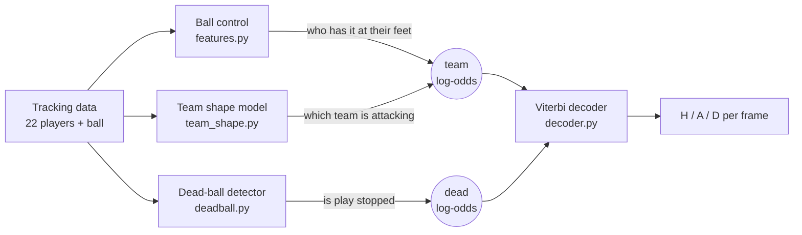

# How the features work

A guided tour of every signal the pipeline computes and how they combine into a label per frame.
[TECHNICAL.md](../TECHNICAL.md) is the short summary for the submission; this document explains
the *why* and the *how* in more depth, with the numbers the code actually uses. Each section names
the file it describes.

---

## 0. The idea in one picture



Three questions are answered separately, frame by frame:

1. **Ball control:** is a player of one team physically controlling the ball right now?
2. **Team shape:** does the way the 22 players are arranged look like home attacking, or away?
3. **Dead ball:** does everything look like a stoppage?

None of them produces labels directly. Each produces **evidence**, a number saying how much more
likely one answer is than another. A decoder then picks the most plausible *sequence* of
possessions, given that every change of possession or stoppage has a price.

### A note on units: log-odds ("nats")

All evidence is expressed as a **log-odds** (natural log). It works like a betting scale:

| log-odds | means |
|---|---|
| 0 | no opinion, 50/50 |
| +1 | ~2.7 : 1 in favour (73%) |
| +2 | ~7.4 : 1 (88%) |
| +3 | ~20 : 1 (95%) |
| −2 | ~7.4 : 1 against |

Evidence from independent sources **adds up**, which is why everything is converted to this scale.
For team evidence, positive means **home** (Barcelona) and negative means **away** (Athletic). For
dead-ball evidence, positive means **dead**.

---

## 1. Preparing the data: `possession/data.py`

### Frame alignment and units
The tracking file has one line per video frame, numbered from 1. Submission row *i* is video
frame *i*, numbered from 0, so `video_frame = frame_id − 1`. Positions arrive as fractions of the
pitch (0–1) and are converted to metres (105.3 × 68 m). Distances and speeds then mean what they
say: 1.2 m is 1.2 m along either axis.

Parsing ~200 MB of text takes ~2 s and is cached in `data/_cache/` (gitignored).

### Which track belongs to which team
The tracker has **46 slots** for 22 players. A slot is a *tracklet*: it can jump from one person
to another when the tracker loses someone. Its **team** is fixed, though.

- If the tracking metadata XML is present, the team comes straight from it.
- If not (our local situation), it is **derived from the data**. The metadata always lists one
  home block of slots, then one away block, each ending with its goalkeeper. Goalkeepers are the
  only slots that sit next to a goal line for an entire half. So we find the two keeper slots,
  and everything up to and including the first keeper is home. On this match that gives slots
  1–24 home and 25–46 away, the same assignment the official baseline uses.

### Which way each team attacks
For each half, the home keeper's average position says which goal home defends. In the 1st half
the home keeper sits near x = 0, so home attacks left → right; the ends swap in the 2nd half.
Every "toward the opponent goal" feature below uses this.

---

## 2. Ball-control evidence: `possession/features.py`

**Question:** *on this frame, is somebody controlling the ball, and which team is he on?*

This is the sharpest signal we have. It decides *where* possessions start and end, but it only
exists on the 59% of frames where the ball is tracked.

### Step 1: nearest player of each team
For each frame we find the closest **home** player and the closest **away** player to the ball,
and their distances `d_home`, `d_away`.

### Step 2: is the ball moving *with* him or *past* him?
A ball rolling at a player's feet moves with him. A pass flying past him at 15 m/s does not,
even if it passes within a metre. So we compute the **ball's speed relative to that player**:
both velocities come from positions 2 frames before and after (0.16 s), and we take their
difference.

### Step 3: control strength (0 to 1)
Two soft conditions multiplied together:

```
reach    = exp(−½ · (d / 1.2 m)²)                       # within about a stride and a half
with_him = 1 / (1 + exp((rel_speed − 6 m/s) / 2 m/s))   # not flying past him
control  = reach · with_him
```

Actual values from the code:

| relative speed ↓ / distance → | 0.5 m | 1.0 m | 1.5 m | 2.0 m | 3.0 m |
|---|---|---|---|---|---|
| 1 m/s (dribbling) | **0.85** | 0.65 | 0.42 | 0.23 | 0.04 |
| 4 m/s | 0.67 | 0.52 | 0.33 | 0.18 | 0.03 |
| 6 m/s | 0.46 | 0.35 | 0.23 | 0.12 | 0.02 |
| 10 m/s (pass flying by) | 0.11 | 0.08 | 0.05 | 0.03 | 0.01 |

### Step 4: turn it into team evidence
```
team_logodds = 1.0 · (control_home − control_away)  +  0.1 · tanh((d_away − d_home) / 3 m)
```
- The first term carries almost all the weight: clear control by one side gives up to about
  ±0.85 per frame.
- The second term is a weak tilt (at most ±0.1) toward whichever team is nearer. It helps with a
  loose ball nobody is touching yet.
- When two players from opposite teams are both at the ball (a duel), the two control terms
  roughly **cancel**. The evidence is then near zero and possession stays where it was. That is
  exactly the rule "contested ball → possession stays with the last team".
- If the ball is **not seen**, or is **outside the pitch** (more than 0.75 m past a line), the
  evidence is **0**. Silence, not a guess.

---

## 3. Team-shape model: `possession/team_shape.py`

**Question:** *without looking at the ball, does the shape of the teams say home or away is in
possession?*

### Why we need it
The ball is missing on 41% of graded frames, and not in short blinks. It disappears in ~150
**long gaps** (median 11 s, some over a minute). Ball-control evidence is silent for all of that.
But football teams move very differently with and without the ball:

- The team **in possession** spreads out (width to stretch the defence), pushes up, and moves
  toward the opponent goal.
- The team **without** the ball compacts, drops behind the ball, and presses: players run *at*
  opponents.

A model that reads these patterns can say who has the ball even when nobody can see it.

### The features (240 per frame)
Everything is computed from both sides' points of view ("us" and "them"), in the attacking
direction of "us" (x = 0 is our own goal):

| family | examples | what it captures |
|---|---|---|
| position | outfield centroid x, deepest and most advanced players, 2nd most advanced | how high the team is |
| size | spread in x and y, length, width, bounding-box area | stretched (attacking) vs compact (defending) |
| territory | share of players in the opponent half, final third, own third | who is camped where |
| movement | mean velocity toward the opponent goal, of the whole team and of its front half | who is going forward |
| pressure | how fast the nearest opponent closes in on each player; spacing to the nearest opponent; players marked within 3 m; players free by 8 m | pressing vs being pressed |
| context | centre of play, gap between team centroids, our front line vs their last line | the whole picture |

Then **time windows**: each key feature is averaged over 1, 2 and 5 s, plus 2 s trends and
look-ahead and look-back windows. The look-ahead windows matter because a team reorganises its
shape 1–3 s **after** it wins or loses the ball. Looking slightly ahead lets the model see the
change sooner.

The 25 per-team statistics, for us, for them, and their difference, plus 4 context features,
make 79 instantaneous features. The time windows bring the total to 240.

### Learning without labels (self-supervision)
We have no human labels and may not use any. So the model learns from frames where **the ball
itself tells us the answer**. A frame becomes a training example ("pseudo-label") when all of
these hold:

- the ball is seen and inside the pitch;
- a player is within 1.5 m of it, with the ball moving under 3 m/s relative to him;
- no opponent is also within 1.5 m (no duel);
- over the surrounding ±1 s, at least 90% of such frames agree on the team.

Gaps of up to 3 s between two controls by the same team are filled in. That yields 54,000
training frames (34% of graded play), labelled entirely by code.

A gradient-boosted tree model (`HistGradientBoostingClassifier`) then learns *shape → team* from
those frames, and is applied to **every** frame, including the ones where the ball is missing.

### Making it fair and calibrated
- **No home bias by construction.** Every frame is shown to the model twice, once as "home is
  us" and once as "away is us", and the two answers are combined antisymmetrically. Swapping
  the teams exactly flips the sign of the output.
- **Honest validation.** The match is cut into 4-minute blocks and the model is tested on
  blocks it never trained on, with an 8 s buffer so the time windows cannot leak across. Random
  frames would leak, because neighbouring frames are nearly identical.
- **Calibration.** Raw scores are rescaled (temperature T ≈ 2) so that "log-odds 2" really means
  ~88%.

### How good it is
Against the pseudo-labels on unseen blocks: **89% accuracy, AUC 0.955**. On real ball-missing
gaps where the same team had the ball on both sides, it got the team right for all 27 such gaps
(94% of frames).

Its weakness is **timing**. Shape changes 1–3 s after the ball does, so accuracy drops to ~64%
within 1 s of a turnover. That is why the decoder trusts it less when ball-control evidence
exists.

---

## 4. Dead-ball detector: `possession/deadball.py`

**Question:** *is play stopped?* (ball out, foul, before kick-off, goal celebration…)

Football has a lot of dead time. In LaLiga the ball is in play only ~51–55 of ~95 minutes, so
getting `D` right matters for every possession boundary next to a stoppage. The detector adds up
several independent clues, each in log-odds (positive = dead):

| clue | how it is computed | evidence |
|---|---|---|
| **ball speed** (ball seen in the pitch) | ball speed smoothed over 0.6 s, read off a curve | still ball +1.0 · 1.4 m/s −0.2 · 2.75 m/s −1.4 · 4.25 m/s −2.3 · fast ball −2.8 |
| **ball outside the pitch** | how far past a line: 0.5 m starts counting, full weight at 2 m; beyond 12 m it is a false detection (a spare ball) and ignored | up to +3 |
| **ball missing** | depends on the length of the **whole gap**: short gaps are often live, long gaps are almost always stoppages; the first 3 s of a gap count up to 1 less | from −0.4 (short gap) to +3.0 (long gap) |
| **ball stays out** | the ball was last seen outside and has not reappeared: it stays dead until the restart | +1.5 |
| **player activity** | average speed of the 5 fastest players over 2 s. In play somebody is always sprinting; at a stoppage everyone walks | −1.5 × (speed − 3.15 m/s), capped at ±2.5 |
| **set-piece placement** | ball still (< 0.8 m/s) for more than 1 s; extra if it sits at a restart spot (touchline, corner, goal area, centre spot, penalty spot) | +0.5, +1.0 more at a spot |
| **kick-off formation** | both teams entirely in their own halves (one player allowed over: the kicker), at least 7 tracked per team, for at least 1 s | +4 |
| **before the kick-off** | from the start of each half until the first kick-off line-up ends. Formation runs less than 30 s apart are merged, because a line-up breaks and re-forms before the whistle | +3 |
| **tracking thins out** | fewer than 20 tracked players (camera on a replay or a celebration) | 0 to +0.7 |

The kick-off rule matters in practice. The 2nd half is graded from about two minutes **before**
its kick-off, and all of that is `D`. The detector finds it from the players' formation, not
from a hard-coded frame number, so it would work on any match.

### Where the numbers come from
They are physical scales (walking vs sprinting speeds, pitch markings) checked against the
tracking itself. [tools/deadball_calibration.py](../tools/deadball_calibration.py) rebuilds them
from scratch with no ground truth:

- **Anchors.** It defines unmistakable situations: ball 2–12 m outside the pitch, kick-off
  formation, ball flying at 8+ m/s inside the pitch, players sprinting.
- **Cross-checks.** It verifies that ball clues separate the *player*-defined situations (AUC
  0.93) and player clues separate the *ball*-defined ones (AUC 0.86), so no clue grades itself.
- **Activity threshold.** It fits the activity curve on the anchors, which gives 3.15 m/s, the
  value used.
- **Ball-context curve.** It estimates how often each ball context is a stoppage, which gives the
  ball-speed and gap curves.

---

## 5. Putting it together: `possession/pipeline.py` and `possession/decoder.py`

### Combining the evidence
```
team = ball_control                                   # section 2
     + w_shape · clip(shape, ±4)                      # section 3; w_shape = 0.03 if ball seen, 0.08 if not
dead = 0.15 · clip(dead_ball, ±6)                     # section 4
```
Why such small weights for shape and dead-ball? Ball control changes frame to frame. Shape and
dead-ball evidence are **smooth**: one opinion lasting several seconds, repeated on 25 frames a
second. Summed at full weight, one opinion would count 25 times a second. The weights bring them
back to roughly "one real opinion per second or so". Shape gets more weight when the ball is
unseen, because then it is the only team evidence.

### The decoder: Viterbi with a price on every change
Each frame is in one of three states, **H**, **A** or **D**. The decoder finds the single
sequence of states that best explains all the evidence over a whole half, with one extra rule:
**every change of state costs 8** (H↔A, and entering or leaving D).

Each frame's evidence becomes a score per state:
```
score(H) = +½ team − ½ dead
score(A) = −½ team − ½ dead
score(D) = +½ dead
```
**Viterbi** is the standard dynamic-programming algorithm that finds the best path through such
a chain. It looks at the whole half at once, so it can place a boundary on the right frame
using evidence that comes later.

### What the price means in football terms
A possession change happens only if the new team's evidence, added up, beats the price of 8:

- **A real turnover:** the opponent takes the ball and dribbles at ~0.85 per frame. After about
  10 frames (0.4 s) the evidence pays for the switch. The decoder then places the boundary where
  the control started, not 0.4 s later, because it sees the whole sequence.
- **A touch or deflection:** the opponent touches the ball for 2–3 frames (~2 of evidence) and it
  goes back. That never pays for one switch, let alone the switch back. **No change.** This is
  the "simple touch without control does not count" rule.
- **Ball invisible:** with only shape evidence (up to 0.32 per frame, typically ~0.16), a switch
  needs about 1–2 s of the shape consistently saying "the other team". A brief wobble in shape
  does not flip possession. A real change in how both teams are organised does.
- **Stoppage:** with strong dead evidence (+3 to +6, i.e. 0.45–0.9 per frame after weighting),
  entering `D` takes ~0.4–0.7 s of consistent evidence. A brief lull in play does not.

When there is no evidence at all, nothing can pay for a change, so the current state simply
carries on. A short stoppage is `H … D … H`: the decoder never labels who "owns" a dead ball.

### What the decoder outputs
- `H`, `A` or `D` for every frame inside the two graded halves, decoded half by half.
- `X` outside them (before kick-off, half-time, after the final whistle), which is never graded.
- No `X` inside the halves. The ranking metric would replace an `X` with our previous label
  anyway, so giving the decoder's best answer is never worse.

---

## 6. Tools for choosing numbers without cheating: `tools/`

We may not tune on the ground truth, not even the public 5 minutes. So how do we know whether a
parameter is reasonable?

- **`tools/sensitivity.py`** changes each parameter by ×0.5, ×0.75, ×1.5 and ×2 and measures how
  much the output changes. It scores each variant against our own base output, using the
  official metric code. A parameter on a **plateau** (small change → nearly the same output) is
  safe. One on a **cliff** is not. All current values are on plateaus: at least 83% agreement
  even when doubled or halved.
- **`tools/deadball_calibration.py`** re-derives the dead-ball constants (section 4).
- **Football sanity checks** on the output, no labels needed:

  | check | our output | typical football |
  |---|---|---|
  | dead time | 45% | ~45–50% |
  | stoppages | 114 | 100–120 |
  | possessions | 248 | — |

---

## 7. Where each piece lives

| file | what it does |
|---|---|
| `possession/data.py` | load and cache the tracking; metres; slot → team; attack directions |
| `possession/features.py` | ball velocity, nearest player per team, control strength, ball-control log-odds |
| `possession/team_shape.py` | shape features, self-supervised training, calibrated team log-odds |
| `possession/deadball.py` | dead-ball clues and their sum |
| `possession/decoder.py` | Viterbi over H/A/D with switching costs |
| `possession/pipeline.py` | combines everything; all decoder parameters in `PARAMS` |
| `make_submission.py` | one command: data → `evaluation/results/yeeclaw.csv` → validation |
| `tools/sensitivity.py` | parameter stability check, no ground truth |
| `tools/deadball_calibration.py` | re-derives dead-ball constants, no ground truth |
